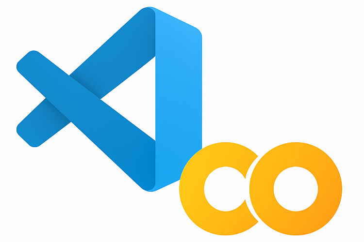
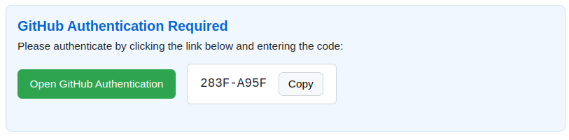
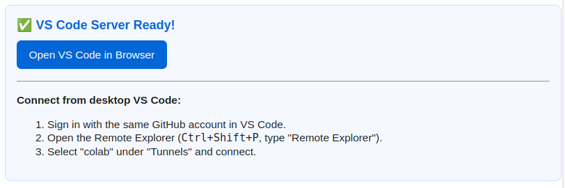

# vscode-colab: Connect VS Code to Google Colab and Kaggle Runtimes

[](https://pypi.org/project/vscode-colab/)
[](https://opensource.org/licenses/MIT)
[](https://pypi.org/project/vscode-colab/)
[](https://colab.research.google.com/github/EssenceSentry/vscode-colab/blob/main/examples/simple_usage.ipynb)
[](https://deepwiki.com/EssenceSentry/vscode-colab)



> **ℹ️ Note:** Google Colab now has an official VS Code extension! For the best experience connecting to Colab runtimes, we recommend using the [official Google Colab extension](https://marketplace.visualstudio.com/items?itemName=Google.colab).

**vscode-colab** is a Python library that seamlessly connects your Google Colab or Kaggle notebooks to Visual Studio Code (VS Code) using [VS Code Remote Tunnels](https://code.visualstudio.com/docs/remote/tunnels). It allows you to leverage VS Code's powerful editor and extensions while using the computational resources of cloud-based notebooks.

## 🚀 Key Features

- **Secure, Official Integration:** Uses official VS Code Remote Tunnels for secure, stable connections.
- **GitHub Integration:** Automatically authenticated via GitHub, enabling seamless cloning and pushing to private repositories.
- **Easy Git Configuration:** Optionally configure global Git identity (`user.name` and `user.email`) directly from the library.
- **Extension Support:** Installs essential Python and Jupyter extensions by default; easily customize by passing additional extensions.
- **Python Environment Management:** Optionally set up a specific Python version for your project using `pyenv`. (Note: Installing a new Python version via pyenv can take approximately 5 minutes).
- **Project Scaffolding:** Optionally create a new project directory with a Python virtual environment.
- **Minimal Setup:** Simple and intuitive `login()` and `connect()` functions.
- **Cross-Platform Compatibility:** Fully supports both Google Colab and Kaggle notebooks.
- **Interactive UI:** Integrated UI within notebooks to manage authentication and tunnel connections easily.

## 🧰 Installation

Install the package using pip:

```shell
pip install vscode-colab
```

## 📖 Usage

[](https://colab.research.google.com/github/EssenceSentry/vscode-colab/blob/main/examples/simple_usage.ipynb)

### 1. Import the Library

In your Colab or Kaggle notebook:

```python
import vscode_colab
```

### 2. Authenticate with GitHub

Authenticate using GitHub credentials:

```python
vscode_colab.login()
```



Follow the displayed instructions to authorize the connection.

### 3. Establish the Tunnel and Configure Git (Optional)

To start the VS Code tunnel, optionally configure Git, set up a Python version, or create a new project:

```python
vscode_colab.connect(
    name="my-tunnel",
    git_user_name="Your Name",
    git_user_email="you@example.com",
    setup_python_version="3.13",  # Optional: Specify Python version to install with pyenv
    create_new_project="my_new_project" # Optional: Create a new project directory
)
```



- By default, VS Code Python and Jupyter extensions are installed.
- You can customize the extensions to be installed:

```python
# Add C++ extensions in addition to default ones
vscode_colab.connect(extensions=["ms-vscode.cpptools"])

# Completely override extensions (only install C++ support)
vscode_colab.connect(extensions=["ms-vscode.cpptools"], include_default_extensions=False)

# Setup a specific Python version and create a new project
# Note: Installing Python with pyenv can take ~5 minutes.
vscode_colab.connect(
    name="py-project-tunnel",
    setup_python_version="3.9",
    create_new_project="data_analysis_project",
    new_project_base_path="~/projects", # Optional: specify where to create the project
    venv_name_for_project=".venv-data" # Optional: specify venv name
)
```

### 4. Connect via VS Code

In your local VS Code:

1. Ensure the [Remote Tunnels extension](https://marketplace.visualstudio.com/items?itemName=ms-vscode.remote-server) is installed.
2. Sign in with the same GitHub account used in the notebook.
3. Open Command Palette (`Ctrl+Shift+P` or `Cmd+Shift+P`).
4. Run `Remote Tunnels: Connect to Tunnel...` and select your notebook's tunnel.

You're now seamlessly connected to Colab/Kaggle through VS Code!

## 🧩 Default Extensions Installed

By default, `vscode-colab` installs the following Visual Studio Code extensions to enhance your Python and Jupyter development experience:

- **[Python Path](https://marketplace.visualstudio.com/items?itemName=mgesbert.python-path)**: Facilitates generating internal import statements within a Python project.

- **[Black Formatter](https://marketplace.visualstudio.com/items?itemName=ms-python.black-formatter)**: Provides code formatting support for Python files using the Black code formatter.

- **[isort](https://marketplace.visualstudio.com/items?itemName=ms-python.isort)**: Offers import sorting features to improve the readability of your Python code.

- **[Python](https://marketplace.visualstudio.com/items?itemName=ms-python.python)**: Adds rich support for the Python language, including IntelliSense, linting, debugging, and more.

- **[Pylance](https://marketplace.visualstudio.com/items?itemName=ms-python.vscode-pylance)**: Enhances Python language support with fast, feature-rich language services powered by Pyright.

- **[Debugpy](https://marketplace.visualstudio.com/items?itemName=ms-python.debugpy)**: Enables debugging capabilities for Python applications within VS Code.

- **[Jupyter](https://marketplace.visualstudio.com/items?itemName=ms-toolsai.jupyter)**: Provides support for Jupyter notebooks, including interactive programming and computing features.

- **[Jupyter Keymap](https://marketplace.visualstudio.com/items?itemName=ms-toolsai.jupyter-keymap)**: Aligns notebook keybindings in VS Code with those in Jupyter Notebook for a consistent experience.

- **[Jupyter Notebook Renderers](https://marketplace.visualstudio.com/items?itemName=ms-toolsai.jupyter-renderers)**: Provides renderers for outputs of Jupyter Notebooks, supporting various output formats.

- **[TensorBoard](https://marketplace.visualstudio.com/items?itemName=ms-toolsai.tensorboard)**: Allows launching and viewing TensorBoards directly within VS Code.

## ⚠️ Important Notes

- **Closing the notebook tab will terminate the connection.**
- **Kaggle Clipboard Limitation:** On Kaggle, the copy-to-clipboard button will display "Copy Failed" in red due to sandbox restrictions. Manually select and copy the displayed code.

## 🧪 Testing

To run tests:

```bash
git clone https://github.com/EssenceSentry/vscode-colab.git
cd vscode-colab
pip install -r requirements-dev.txt
pytest
```

## 🛠️ Development

- Configuration via `setup.cfg`
- Development dependencies listed in `requirements-dev.txt`
- Contributions welcome—open a GitHub issue or PR!

## 📄 License

MIT License. See [LICENSE](https://github.com/EssenceSentry/vscode-colab/blob/main/LICENSE).

## 🙏 Acknowledgments

Special thanks to the developers behind [VS Code Remote Tunnels](https://code.visualstudio.com/docs/remote/tunnels) for enabling this seamless remote development experience.
